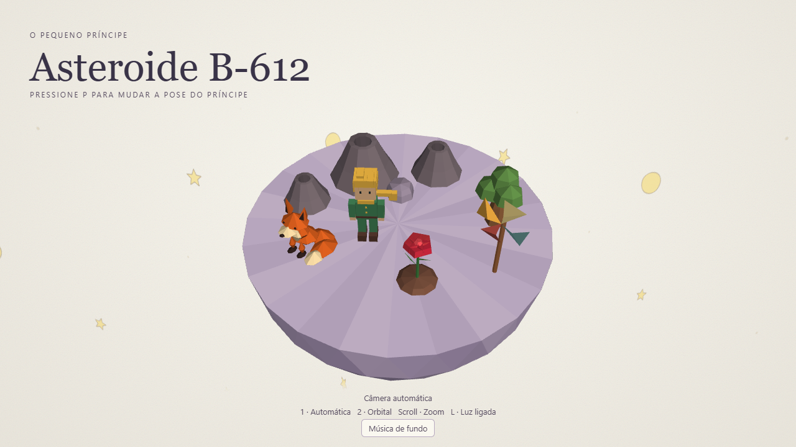

# Asteroide B-612

Um avião cai no Saara. Em 1935, Antoine de Saint-Exupéry viveu essa cena ao lado de seu mecânico e sobreviveu. Anos depois, em *O Pequeno Príncipe*, outro aviador fica sozinho no deserto, tentando consertar o avião. É ali que aparece um menino de outro planeta, pedindo que ele desenhe um carneiro. [A vida do aviador e o manuscrito do livro](https://madparis.fr/A-la-rencontre-du-petit-prince-2120)

No livro, é no deserto que a gente ouve falar do B-612 pela primeira vez. No nosso trabalho, dá pra ir até lá, dar uma volta e ficar um pouco com o príncipe, a rosa e a raposa.

## A Cena

Recriamos o asteroide do Pequeno Príncipe em WebGL, com a rosa, a raposa, três vulcões, um broto de baobá e um catavento. O chão lilás e o fundo com textura de papel vieram da ideia de fazer a cena parecer uma ilustração da capa do livro.

[Abrir a cena](https://luccamolinari.github.io/tp2-cg/) · [Ver o repositório](https://github.com/luccamolinari/tp2-cg)

| Controle | O que faz |
| --- | --- |
| `1` | Ativa a câmera que gira sozinha. |
| `2` | Ativa a câmera que você gira arrastando a cena. |
| Scroll | Aproxima ou afasta a câmera. |
| `P` | Alterna entre o príncipe em pé, sentado numa pedra e deitado. |
| `L` | Liga ou desliga a iluminação. |
| `T` | Alterna a velocidade do ciclo dia/noite entre 1× e 4×. |
| `M` ou botão de música | Liga ou desliga a trilha. |

## Criadores

- Lucca Molinari — [@luccamolinari](https://github.com/luccamolinari)
- Nicolas — [@NicoDeVargas](https://github.com/NicoDeVargas)

## Media kit

## Opcionais

> ⭐ Skybox, skyphere ou skydome: se considerarmos que nosso mundo está definido dentro de um cubo (skybox), podemos colocar uma imagem de textura em cada face interna (são 6) que represente o horizonte naquela direção. Veja exemplos de texturas de skyboxes e nossa aula sobre efeitos visuais. Repare que o cubo do skybox acompanha a posição, ou seja, não é possível se aproximar de uma parede, muito menos sair do cubo

As estrelas são desenhadas numa esfera que acompanha a posição da câmera. Quando a câmera gira, muda a parte do céu que aparece na tela.

> Poses alternativas: ao alternar as poses do personagem com P, além de mudar a posição e orientação, coloque-o de fato em outra pose (eg, sentado, deitado, dormindo)

O príncipe muda de postura e de lugar no asteroide. Na pose sentada, ele se apoia numa pedra perto dos vulcões.

> 🍔 Efeitos de partículas: para simular fenômenos como fogo, fumaça, água etc. Falaremos disso na aula de efeitos visuais

Os dois vulcões ativos soltam fumaça. As partículas sobem, se espalham e desaparecem aos poucos.

> 🍔 Ciclo dia/noite: faça o tempo passar e que isso defina na forma como o cenário é renderizado. Isso pode ser feito configurando-se a fonte de luz direcional com cores diferentes, dependendo da hora do dia
>
> Se tiver um skybox, você deve alterá-lo para refletir os horários diferentes

O ciclo dura 48 segundos na velocidade normal e 12 segundos na velocidade 4×. A cor da luz, o fundo e o brilho das estrelas mudam juntos.

> 🌟 Música, efeitos sonoros e/ou som ambiente: inclua música de fundo, sons ambiente e efeitos sonoros (este último, caso haja algum tipo de interação)

A trilha é um loop instrumental sintetizado no navegador. Ela começa ao apertar `M` ou clicar no botão de música.

## Créditos

A cena é inspirada em *O Pequeno Príncipe*, de Antoine de Saint-Exupéry. A capa serviu de referência para a paleta de cores e os desenhos do céu. Os modelos, as ilustrações e a música foram criados para o projeto.
